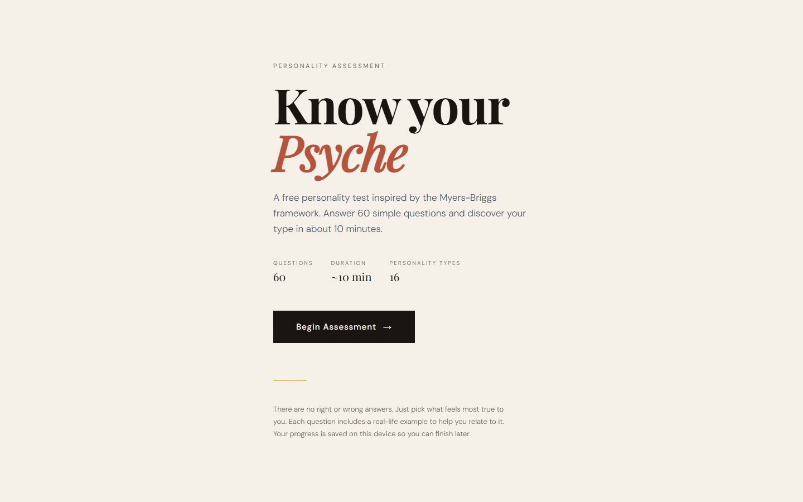
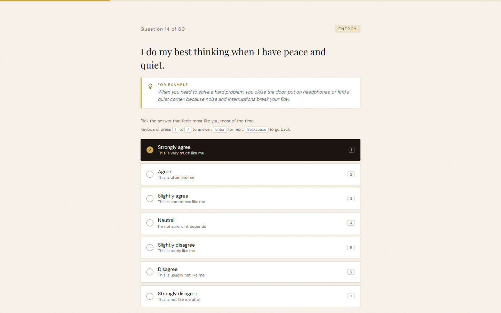
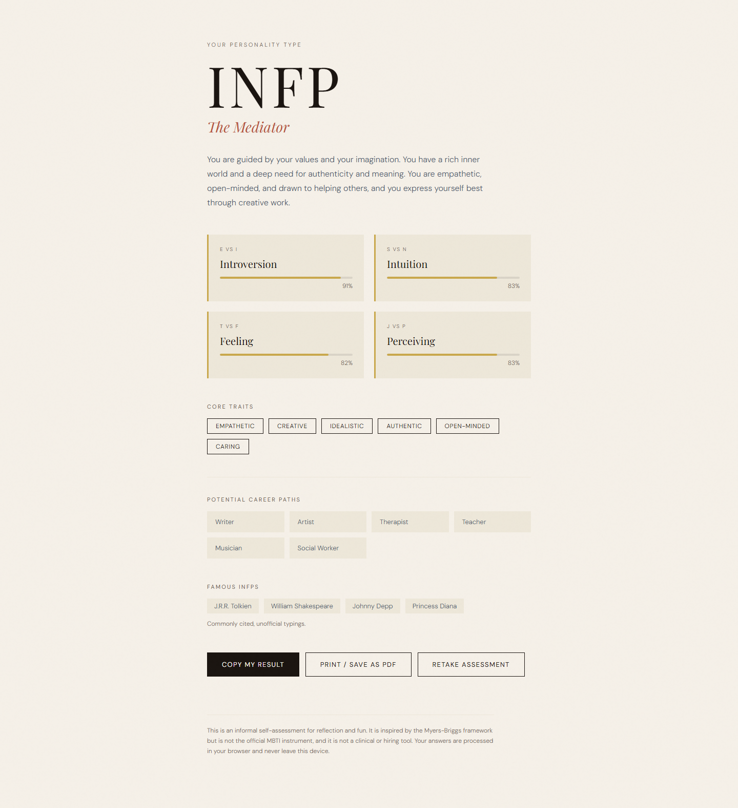
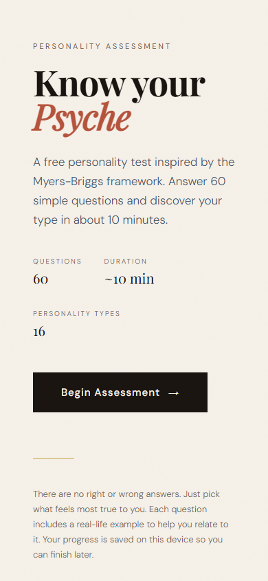
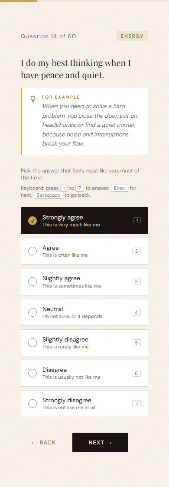
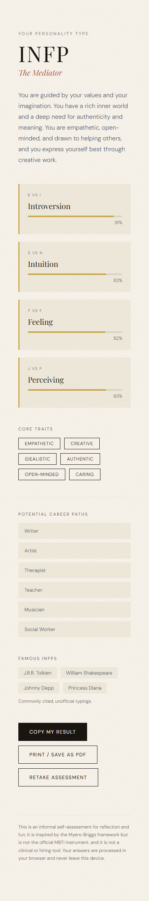

# Psyche Personality Test

A 60-question personality test inspired by the Myers-Briggs framework. Each question comes with a real-life example, answers use a 7-point agree/disagree scale, and the result gives your four-letter type, dimension strengths, core traits, career paths and famous examples.

It is a single self-contained file, `index.html`, with no build step or backend. The only external resource is Google Fonts. Answers are processed in the browser and never leave the device.

Open `index.html` in any browser to take the test.

## Preview

### Desktop

| Intro | Question |
| --- | --- |
|  |  |

Results page

### Mobile

  

## What was improved

**New features**
- **Save and resume:** Progress is saved on the device after every answer. If you leave, the intro offers "Resume (N of 60 answered)", and starting again clears it.
- **Keyboard support:** Press `1` to `7` to answer, `Enter` for next, `Backspace` to go back.
- **Copy my result:** Copies a one-line summary of your type and dimension percentages to the clipboard.
- **Print / save as PDF:** Print styles hide the controls so the results page prints cleanly.
- The result updates the browser tab title and moves focus to your type for screen readers.

**Fixes**
- Answer buttons are built from valid markup (the original put `div` elements inside `button`) and use proper radio semantics with `aria-checked`.
- Duplicate famous people were removed (Mother Teresa appeared under two types, Mark Twain under two), and the list is labelled as commonly cited, unofficial typings.
- Lighter text colours were darkened for readability, including the gold labels and muted greys.
- The emoji lightbulb is now an SVG icon.
- A short disclaimer on the results page makes clear that this is not the official MBTI instrument.
- Skip link, focus styles, a labelled progress bar and `prefers-reduced-motion` support.
- All em dashes removed from the questions, scenarios, type descriptions and title.

**Checked**
- Every dimension has 15 questions with 8 and 7 in opposite directions, so a person cannot get a type just by agreeing with everything.
- All 16 types were verified to be reachable with the expected four-letter result, and a full run through the interface produced the right result.

The original fonts, colours, questions, scoring and copy were kept.

## Notes

- A dimension that scores exactly 50% resolves to the first letter of the pair (E, S, T or J).
- Saved progress uses `localStorage`. If the browser blocks storage, the test still works and simply does not save.
